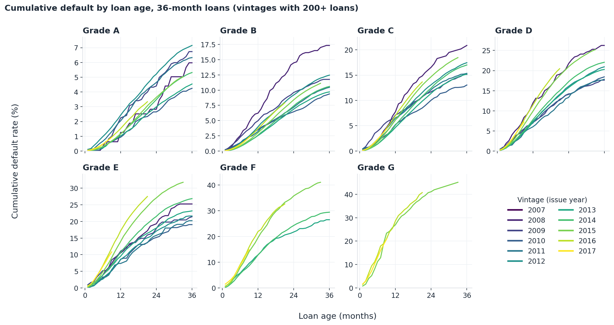
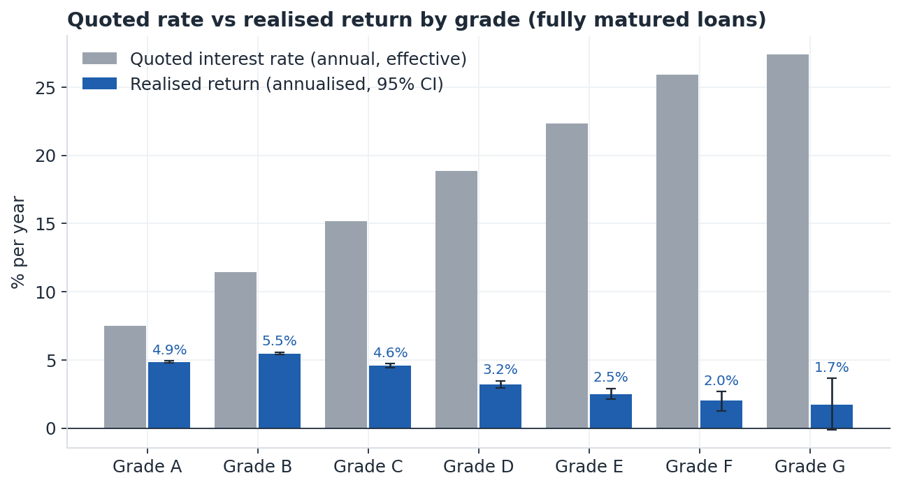
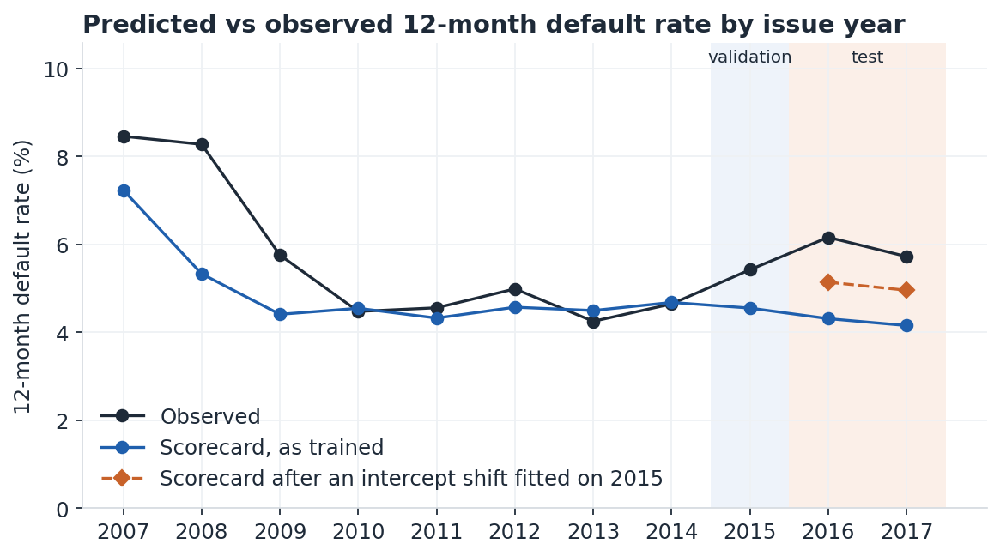

# Lifetime credit loss on Lending Club loans

**Question.** Did Lending Club price risk correctly, and how well can public application data predict who defaults?

**Answer (v1).** Not in the later vintages. Riskier grades defaulted faster in 2015–16 than in earlier years. On fully matured loans, grades C to G earned lower realised returns than A and B despite charging much higher rates; that pattern comes from the 2014–15 vintages, which make up most of the matured sample (in 2010–13 riskier grades did earn more). A scorecard built on public application data ranks 12-month default risk with an out-of-time Gini of 0.30, below Lending Club's own sub-grade (0.40), and its predictions fall further behind observed default rates every year after 2014.

Status: **v1 (Stages 1–3) complete.** Stages 4–7 (survival model, scenario ECL, profit cutoff, model risk) follow the plan in [`docs/PLAYBOOK.md`](docs/PLAYBOOK.md).

## Findings

**1. Newer risky-grade vintages defaulted faster** (36-month loans, cumulative default by month 12). Grade D: about 7% for 2012–13 loans, 9.9% for 2015, 11.4% for 2016. Grade E: 9.5% (2013) to 17.2% (2016). Grades A and B barely moved. Context, not a proven cause: Lending Club expanded lending sharply in 2015–16.



**2. Grades C to G earned less than A and B.** Annualised realised return on 676,302 fully matured loans (36-month loans issued 2007–15, 60-month loans issued 2007–13):

| Grade | A | B | C | D | E | F | G |
|---|---|---|---|---|---|---|---|
| Quoted rate | 7.5% | 11.5% | 15.2% | 18.9% | 22.3% | 25.9% | 27.4% |
| Realised return | 4.9% | 5.5% | 4.6% | 3.2% | 2.5% | 2.0% | 1.7% |

95% bootstrap intervals by loan are in `reports/tables/s2_return_by_grade.csv`; from grade D down they do not overlap with A or B. On 36-month loans only, the pattern holds and is stronger at the bottom (E 0.7%, F −1.7%, G −4.0%), so it is not a term effect. The F and G figures rest on small samples (4,465 and 683 loans) and are noisy: the 95% interval for F runs from −3.2% to 0.0%, and for G from −7.7% to −0.3%. By vintage it is not constant: grades D and E beat grade A in 2011–13 and fell well below it in 2014–15, the years that dominate the matured sample.



**3. Lending Club's own grade beats a public-data scorecard.** Test years 2016 to Sep 2017, 759,338 loans:

| Model | Train Gini (2007–14) | Validation Gini (2015) | Test Gini (2016–17) |
|---|---|---|---|
| WoE scorecard, 9 borrower variables | 0.33 | 0.33 | 0.30 |
| Gradient boosting, monotone, regularised | 0.42 | 0.37 | 0.33 |
| Lending Club sub-grade alone | 0.34 | 0.42 | 0.40 |
| Scorecard + sub-grade | 0.38 | 0.42 | 0.40 |

The scorecard adds nothing once the sub-grade is known. This likely reflects information Lending Club had that is not in the public file (the full credit report and its own data); that is a hypothesis, not tested here. The gradient-boosting benchmark is only slightly better than the scorecard out of time, after a small regularisation grid tuned on 2015.

**4. The scorecard's predictions drift below observed default rates after 2014.** Observed ÷ predicted 12-month default: 0.95–1.09 in 2010–14, 1.19 in 2015, 1.43 in 2016, 1.38 in 2017 (4.2% predicted vs 6.0% observed on the test years, about 29% too low). The downturn years were under-predicted too, even inside the training period: 1.55 for 2008 and 1.31 for 2009 loans. A model on borrower data alone misses conditions that move default rates for everyone, which is the case for adding macro variables in Stage 4. An intercept shift fitted on 2015 alone closes about half of the test gap, so the drift kept growing after the validation year. Ranking held up (score PSI below 0.03), but levels did not: this is what Stage 4's vintage and macro effects need to explain.



## Method in brief

- **Data:** 2,260,668 loans issued Jun 2007 to Dec 2018; snapshot (latest payment) Mar 2019. 912,569 loans were still open and are excluded from lifetime results. Data-quality note: [`reports/DATA_QUALITY.md`](reports/DATA_QUALITY.md).
- **Default:** charged off or default status; default month = first missed payment. Lifetime results use resolved loans only. The PD model uses default within 12 months, known for every loan 18+ months old at the snapshot (1,646,778 loans), so open loans are not mislabelled. Every rule and choice is in [`ASSUMPTIONS.md`](ASSUMPTIONS.md).
- **Vintage curves:** every loan in the vintage stays in the denominator; ages shown only up to the youngest loan's age minus 6 months.
- **Realised return:** approximate IRR from Lending Club's payment totals, recoveries 6 months after the last payment, no servicing fee. It returns the quoted rate on fully paid loans (grade A 7.38% vs 7.45%).
- **Scorecard:** quantile bins merged to follow the expected risk direction, WoE and information value on 2007–14, logistic regression; all coefficients have the expected sign. Interest rate and grade are excluded so the scorecard can be compared with Lending Club's grades. Split by issue year, never at random; boundaries fixed before results.

## Limits

- Associations, not causes. The 2015–16 loosening is context for the vintage pattern, not a tested explanation.
- Realised return ignores Lending Club's investor servicing fee (about 1% of payments) and reinvestment, and approximates the payment schedule from totals.
- The matured-loan sample is dominated by 2014–15 loans; pooled grade results should be read with the by-vintage table.
- The rejected-applications file is not yet used: every result describes approved loans only.

## Run it

```
python -m venv .venv && source .venv/bin/activate
pip install -r requirements.txt
make all          # stage 1-3 tables, figures and tests (about 10 minutes on a laptop)
```

Tested with Python 3.10. Put the raw files in `data/raw/` first (not committed). `LC_DB=/path/lc.duckdb make all` keeps the DuckDB file elsewhere. Fitted gradient-boosting models are cached in `data/clean/gbm_cache/` and cleared by `make stage1` or `make clean`. Two fresh rebuilds give identical tables (fixed seed, rows sorted by loan id before any sampling).

## Data

| Source | File | Licence | Downloaded |
|---|---|---|---|
| Lending Club accepted loans 2007–2018Q4, Kaggle `wordsforthewise/lending-club` | `accepted_2007_to_2018Q4.csv` | CC0: Public Domain | 11 Nov 2026 |
| Lending Club rejected applications, same dataset | `rejected_2007_to_2018Q4.csv` | CC0: Public Domain | 11 Nov 2026 |
| FRED: US unemployment rate (`UNRATE`), 3-month Treasury bill (`TB3MS`) | `UNRATE.csv`, `TB3MS.csv` | US government data via FRED | 11 Nov 2026 |

## Files

| Path | What it is |
|---|---|
| `sql/01_load.sql` – `04_vintage.sql` | Load, typed tables and outcomes, blocking data checks, vintage curves |
| `src/stage1_report.py` | Default-rate-by-year chart and the data-quality note |
| `src/stage2_returns.py`, `src/returns.py` | Realised return (approximate IRR) and grade tables |
| `src/stage3_scorecard.py`, `src/woe.py`, `src/validation.py`, `src/features.py` | Scorecard, benchmark, validation |
| `tests/` | Default definition, 12-month target, IRR, binning and metrics |
| `reports/tables/`, `reports/figures/` | Every reported number and chart |
| `ASSUMPTIONS.md` | Every rule and number chosen by hand |
