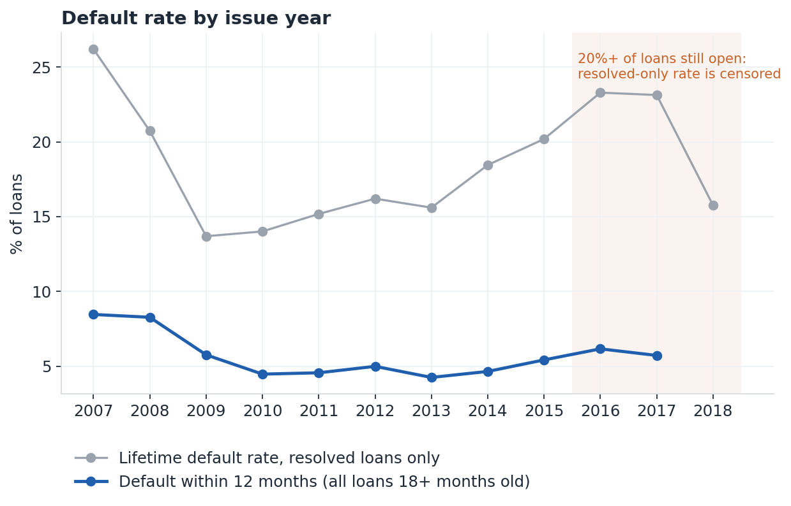

# Data-quality note (Stage 1)

Generated by `make stage1` from `reports/tables/`. Snapshot month: **2019-03-01**; loans issued 2007-06-01 to 2018-12-01.

## Row funnel
| step | loans |
|---|---|
| rows in file | 2,260,701 |
| summary rows without a loan amount (dropped) | 33 |
| loans | 2,260,668 |
| ... still open at the snapshot (no final outcome) | 912,569 |
| ... resolved: paid | 1,078,739 |
| ... resolved: default | 269,360 |
| ... of which "does not meet the credit policy" (kept, flagged) | 2,749 |
| loans with a known 12-month outcome (18+ months old) | 1,646,778 |

## Blocking checks (all must be 0)
| test | failures |
|---|---|
| duplicate loan ids | 0 |
| missing loan id | 0 |
| missing or unparsed issue month | 0 |
| missing grade | 0 |
| term not 36 or 60 months | 0 |

## Impossible or suspicious values
| issue | loans | treatment |
|---|---|---|
| annual income <= 0 | 1,667 | set to missing |
| annual income > 5,000,000 | 93 | kept (WoE bins and trees are insensitive to extremes) |
| debt-to-income < 0 | 2 | set to missing |
| debt-to-income > 100 | 2,561 | set to missing (sentinel or data error) |
| revolving utilisation > 150% | 28 | capped at 150 |
| FICO outside 300-850 | 0 | set to missing |
| funded amount > requested amount | 0 | kept |
| last payment before issue | 0 | dates out of order; exit age floored at 1 |
| first credit line after issue | 0 | history set to missing |
| principal or interest received but no last-payment date | 1 | exit age set to 1 |
| interest rate outside 5%-31% | 0 | kept |

## Missing values per feature (features with any missing)
| feature | column_type | pct_missing |
|---|---|---|
| emp_length_yrs | INTEGER | 6.5 |
| mort_acc | DOUBLE | 2.21 |
| dti | DOUBLE | 0.08 |
| revol_util | DOUBLE | 0.08 |
| installment_to_income | DOUBLE | 0.07 |
| pub_rec_bankruptcies | DOUBLE | 0.06 |

## Default rate by issue year
| issue_year | loans | pct_still_open | resolved_loans | default_rate_resolved_pct | loans_12m_known | default_rate_12m_pct | pct_60_month |
|---|---|---|---|---|---|---|---|
| 2,007 | 603 | 0.0 | 603 | 26.2 | 603 | 8.46 | 0.0 |
| 2,008 | 2,393 | 0.0 | 2,393 | 20.73 | 2,393 | 8.27 | 0.0 |
| 2,009 | 5,281 | 0.0 | 5,281 | 13.69 | 5,281 | 5.76 | 0.0 |
| 2,010 | 12,537 | 0.0 | 12,537 | 14.01 | 12,537 | 4.47 | 27.0 |
| 2,011 | 21,721 | 0.0 | 21,721 | 15.18 | 21,721 | 4.56 | 35.1 |
| 2,012 | 53,367 | 0.0 | 53,367 | 16.2 | 53,367 | 4.99 | 18.5 |
| 2,013 | 134,814 | 0.0 | 134,804 | 15.6 | 134,814 | 4.25 | 25.5 |
| 2,014 | 235,629 | 5.3 | 223,103 | 18.45 | 235,629 | 4.65 | 31.0 |
| 2,015 | 421,095 | 10.8 | 375,546 | 20.19 | 421,095 | 5.42 | 32.8 |
| 2,016 | 434,407 | 32.5 | 293,105 | 23.29 | 434,407 | 6.16 | 25.5 |
| 2,017 | 443,579 | 61.8 | 169,321 | 23.13 | 324,931 | 5.72 | 27.8 |
| 2,018 | 495,242 | 88.6 | 56,318 | 15.76 | 0 | nan | 30.4 |

**Reading the drift plot.** The resolved-only default rate for recent issue years is not comparable with earlier years: many recent loans are still open, and the ones that have already finished are disproportionately early defaults and early payoffs. This is right-censoring, not better or worse lending. The 12-month rate, measured on every loan old enough to have a known 12-month outcome, is the comparable series.
